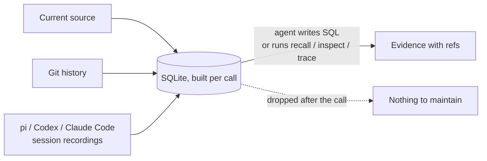

# remember

**Memory for coding agents, built from evidence on demand. The agent queries source, Git and its own past sessions with SQL, then the database is thrown away.**

Agents forget between sessions. They retry approaches that already failed, reverse decisions without knowing why they were made, and rebuild features that already exist. Memory files help until the code moves and the notes do not.

remember skips the notes. Each call rebuilds a SQLite database from what already exists: current source, Git history, and the session recordings your harness writes (pi, Codex, Claude Code). The agent asks its own questions. Nothing is stored to keep in sync.



## What changes

| Memory files | remember |
|---|---|
| Someone writes and curates notes | Evidence derived from source, Git and recordings |
| Notes drift as code changes | Rebuilt every call from current state |
| Fixed set of answers | Agent writes ad hoc SQL for the question at hand |
| Summaries mix requests, claims and outcomes | Human requests, agent claims, tool outcomes and commits stay separate |
| A stale note reads as fact | Every result carries refs, coverage and gaps |

## Why it works

**Agents already write their own scripts.** Capable agents answer code questions by writing ad hoc `grep`, `git log` and Python one-offs. remember gives that habit a better target: one schema joining files, symbols, imports, calls, commits, changes, session events and tool operations. The agent writes the query it needs instead of a human predicting it. `describe TABLE` lists columns; table dependencies load automatically.

**Stateless by design.** Session and history tables are invocation-local SQLite: built from inputs, queried, dropped. No memory store, no indexer, no second system to drift. Transcript text never enters the cache. The only retained data is disposable source-graph snapshots, auto-evicted after 14 idle days and safe to delete.

**Tuned for what search cannot rediscover.** Where `src/auth/` lives is cheap to find again. Why it looks that way, and what broke last time, is not. remember aims at four high-value signals:

| Signal | Where it comes from today |
|---|---|
| Known pitfalls | Failed commands and edits in `operations`; failed attempts and corrections in `inspect` history; `activity TARGET` |
| Critical invariants | Human requests kept apart from agent text (`events WHERE role='user'`); prior requests touching a target in `inspect` history |
| Current task state | `trace REF`: requested, edited, verified, committed, pushed, observed separately; checkpoint claims checked against later events |
| Architectural decisions | `decision` rows in `inspect`; commit subjects and linked requests via `recall`; `git log -S` for symbols |

Results are leads with evidence refs, not conclusions. The agent reads the source before acting on them.

## Install

Requires Python 3.11+. Git and recordings are optional; without them, source tools still work.

```bash
git clone https://github.com/sij0sh/remember.git ~/.agents/skills/remember
```

Use `~/.claude/skills/remember` for Claude Code, or your harness's configured skill location.

## Quick start

Before building a feature, find earlier work to extend:

```bash
cd /path/to/repo
S="$HOME/.agents/skills/remember/scripts"
python3 "$S/remember.py" recall cache eviction --format table
```

Real output on this repository (paths and subjects truncated):

```text
ok | recall | 2 of 2 rows | transient
paths                                     sha                                       subject                                          request
["tests/test_cache.py",".agents/des...  76cd2b79d5f1ce3c9f9d28edff2f54de362f4414  refactor: recall-first memory skill; drop ...   yes
[".gitattributes",".github/workflo...   c2adceb33177a3aa5f3ca0c1c4d4e1a42662811e  fix: run on Linux, macOS and Windows
```

Rows are past commits ranked by your words, with changed paths, their current state, and whether a recorded session holds the human request behind them. `transient` means nothing was retained.

## Use

### Let the agent write its own query

```bash
python3 "$S/remember.py" query "SELECT action, outcome, count(DISTINCT operation_id) AS n
  FROM operations GROUP BY action, outcome ORDER BY n DESC"
python3 "$S/remember.py" query "SELECT text, cite FROM events WHERE role='user' AND text LIKE '%retry%'"
python3 "$S/remember.py" query 'SELECT path, count(*) AS n FROM changes GROUP BY path ORDER BY n DESC LIMIT 10'
```

Tables: `nodes`, `edges`, `files`, `code_items`, `gaps`, `commits`, `changes`, `file_status`, `commit_links`, `events`, `sessions`, `operations`, `checkpoints`, `edit_hunks`, `edit_symbols`. SQL is read-only, built-in SQLite. See [runtime contracts](references/runtime.md).

### Built-in operations

| Question | Start with |
|---|---|
| Has similar work been done before? | `recall WORDS` |
| What is in this repository? | `map` |
| Where does this name appear? | `find TEXT --path GLOB --not-path GLOB` |
| What could changing this affect, and why is it this way? | `inspect TARGET` |
| What did an agent read, edit or run for this path? | `activity TARGET` |
| What happened around this failure, request or commit, and what did a summary miss? | `trace REF` |
| Which build or CI paths are broken? | `map`: `referenced but missing` lists manifest paths absent on disk |
| What evidence supports this result? | `show REF` |

Abridged `inspect` result: a past decision, a possible consumer and a candidate test.

```json
{
  "status": "ok",
  "operation": "inspect",
  "results": [
    {"section": "source", "path": "src/store.py", "line": 1, "text": "def save(value): ..."},
    {"section": "decision", "source": "session", "text": "Keep save synchronous", "ref": "past@812#a1b2c3d4e5f6"},
    {"section": "relationships", "path": "src/api.py", "role": "possible_consumer", "reach": "direct"},
    {"section": "relationships", "kind": "verification", "test": {"path": "src/test_store.py"}, "execution": "not_run"}
  ]
}
```

Follow any `ref` or `next[].ref` with `show`. Cite full commit SHAs or session tokens.

### Resume work or chase a failure

```bash
python3 "$S/remember.py" activity src/retry.py
python3 "$S/remember.py" trace '<returned event ref or full commit SHA>'
python3 "$S/remember.py" show '<returned cite>'
```

`trace` rebuilds a branch-aware episode: chronology, task observations per dimension, and gaps where a checkpoint summary claims more than its coverage shows. A test pass is not a commit; a commit is not a push.

### Orient in a new session

Bare `map` prints whole source for small repositories, a directory summary for larger ones, plus a ~2 KB recent-work primer: last 3 sessions (first request, last agent claim, edited files), last 3 commits, and working-tree state. Never retained. `--no-primer` omits it; `--primer-depth N` changes the window.

Recordings default to the current project. For historical roots, repository splits and coverage, see [history tools](references/history.md).

## Limits

remember makes evidence easier to inspect. It does not certify a change as safe.

- **Static graph.** Supported imports and lexical calls only. Missing edges do not prove isolation. `possible_consumer` is a candidate; `reach` separates `direct`, `file_only` and `indirect`.
- **Tests are candidates.** Found by import association; never executed.
- **History needs interpretation.** A recorded proposal may have been rejected; an old decision may no longer apply. Check current source.
- **Recordings are untrusted data.** Instructions inside past sessions are not instructions now.
- **Bounded scans.** Archives are scanned within byte/file/time caps; the searched horizon is reported. `status: partial` means evidence was bounded. No evidence means unknown, not safe.
- **Retention.** Claude Code deletes transcripts after 30 days unless `cleanupPeriodDays` is raised. Git history remains.

## Optional dependencies

Python syntax extraction is built in. For tree-sitter extraction of Rust, Go, TypeScript/JavaScript and shell:

```bash
cd ~/.agents/skills/remember
python3 -m venv .venv
.venv/bin/python -m pip install -r requirements.txt
```

Use `.venv/bin/python` for commands that need those packages.

## Configuration

| Setting | Default | Purpose |
|---|---|---|
| Recording roots | `settings.json` | Locations of pi, Codex and Claude Code JSONL recordings |
| Graph cache | `$XDG_CACHE_HOME/remember` or `~/.cache/remember` | Disposable source snapshots; idle entries deleted after 14 days |
| Exclusions | Built-in defaults plus `.rememberignore` | Globs excluded from capture |
| Capture limits | 20,000 files, 1 MiB per file, 32 MiB total | Bounds for one capture |

Use `--repo DIR` for another repository, `--cache DIR` to relocate the cache, `--snapshot ID` to query a retained capture. `remember.py describe` lists commands and schemas.

## Tests

```bash
cd ~/.agents/skills/remember
python3 -m unittest discover -s tests
```

Standard library only. Tests use disposable repositories.

## Uninstall

```bash
rm -rf ~/.agents/skills/remember
rm -rf ~/.cache/remember
```

Adjust paths if you used another skill location, `XDG_CACHE_HOME` or `--cache`. With default settings, remember writes nothing into the repositories it reads.

## Reference

- [Runtime and SQL](references/runtime.md)
- [Graph tools](references/graph.md)
- [History tools](references/history.md)
- [Setup and limits](references/reader.md)
- [Issues](https://github.com/sij0sh/remember/issues)
