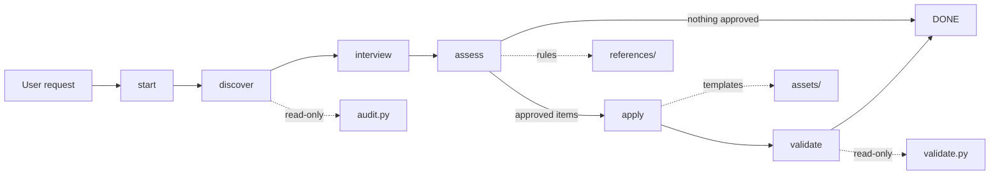

# Architecture

`foundation` is a stateless, agent-driven workflow. A script owns the stage order; the agent performs one stage per execution and carries the results forward.

## Components

- `scripts/workflow.py` is the CLI. `start` prints the first stage; `done --stage S` validates the finished stage's JSON payload and prints the next; `validate` always ends the run.
- `scripts/workflowlib/steps.py` is the single source of stage order, prompts, payload checks, and the capability baseline. `MODE = 'stateless'` means nothing is saved between executions.
- `scripts/workflowlib/flow.py` implements start/status/done/abandon for both modes; `cli.py` handles JSON input and printed commands; `storage.py` provides the optional stateful backend.
- `scripts/audit.py` scans file evidence and git facts without executing project code. `scripts/validate.py` parses only changed or untracked files and checks for committed secrets.
- `references/` supplies greenfield and brownfield rules; `assets/` supplies templates that `apply` adapts to the target repo.

## Invariants

- **Stateless:** the orchestrator carries the user's request and earlier stage results. No run state is written.
- **Read-only tools:** `audit.py` and `validate.py` never run project code.
- **Consent before writes:** no project file is written until the user approves specific items in `assess`.
- **Portable runtime:** scripts remain Python 3.9+ and standard-library-only; optional parsers degrade to `skipped`.
- **One capability per change:** `apply` writes only approved items and keeps existing project conventions.
- **Decisions:** accepted and declined items are recorded in `.agents/foundation.json` for the next run.

## Data flow

The user request enters at `start`. `discover` passes audit JSON and a classification to `interview`, which records decisions; `assess` turns the baseline and evidence into a report and an approval list. If the list is empty the run ends. Otherwise `apply` writes the approved files and the decisions record, then `validate` runs the approved checks and reports the remaining gaps.
