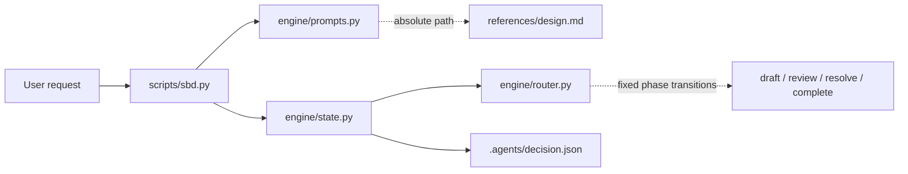

# Architecture

Status: current

`simple-by-design` is a local CLI that routes one agent through a fixed, loop-free design sequence: draft → review → complete, or draft → review → resolve → complete. It is design-only; there is no ledger, agent-selected workflow or implementation step.

## Components

- `scripts/sbd.py` is the CLI. It starts a run with `--request`, resumes with no arguments, and accepts one result with `done TICKET`. It prints the next prompt or resumption command; errors go to stderr with a resume hint.
- `scripts/engine/router.py` owns checkpoint schema 5, result shapes and transitions. `phase` is `draft`, `review`, `resolve`, `blocked` or `complete`; payload keys appear only when needed. `draft` accepts `candidate`; `review` accepts `pass` or `revise` (gaps checked as pair, defeater, decision or unknown); `resolve` accepts `resolved` (final candidate plus one resolution per gap witness) or `blocked`. No result returns to an earlier phase. `advance` rotates the opaque ticket on every non-final result. Completion drops the ticket and stores the full record: request, candidate, and either the passing review or gaps plus resolutions.
- `scripts/engine/state.py` is the only writer. It resolves the task root, stores `.agents/decision.json` with sibling `.decision.lock` and temporary files, serialises writers with `flock`, rejects symlinked ancestors and non-regular files, and writes atomically via temporary file, `fsync`, `os.replace` and directory `fsync`. Duplicate JSON keys are rejected. Old-path or pre-schema-5 state fails closed without auto-import. Completion is one write, so a pre-replace failure leaves the review or resolve prompt needing its result again; a post-replace failure leaves either the old prompt or the already-valid complete record. No `.agents/artifacts/` path is read, written or checked.
- `scripts/engine/prompts.py` holds the static prompt text, the JSON contract, bounded context and the completed-record summary renderer. Every prompt appends an absolute path to `references/design.md`. The printed return command uses absolute paths.
- `references/design.md` holds common design defaults, ten language profiles and the instruction-design rule. The agent reads it on demand; it is not embedded in every prompt.
- `tests/` holds the stdlib `unittest` suite covering routing, state, atomic completion recovery, concurrency, prompt disclosure and instruction budgets.

## Invariants

- **Design only:** prompts and completion never authorise implementation or external effects.
- **Single pass:** each phase runs at most once; resolve output is final and not re-reviewed.
- **One state owner:** the CLI owns transitions; the agent supplies only the requested result.
- **Opaque tickets:** a ticket is accepted once, only for the current prompt; stale or duplicate results do not advance. `complete` keeps no ticket because it accepts no results.
- **Fail closed:** corrupt, legacy or symlinked state is refused rather than repaired.
- **Portable runtime:** Python 3.11+ on POSIX, standard library only.
- **Bounded instructions:** SKILL body ≤100 words; ordinary emitted static surface ≤400 words; guidance ≤350 words; combined ≤750 words.
- **No ledger:** one current snapshot, no history, workflow selection or agent-authored next step. The completed state is the durable record; the terminal summary is a rendered view and no Markdown artifact is written.

## Data flow

A request enters `sbd.py` and becomes a checkpoint. The agent performs the printed prompt, submits JSON through the printed ticket, and receives the next prompt. A passing review completes; `revise` routes named gaps to `resolve`, whose `resolved` result completes; `blocked` pauses resolve until resumed. Completion writes the full record in one atomic checkpoint replace and prints the rendered summary followed by `DONE`. Re-running the same `--request` text replays that summary without writing; a different request replaces the record.
